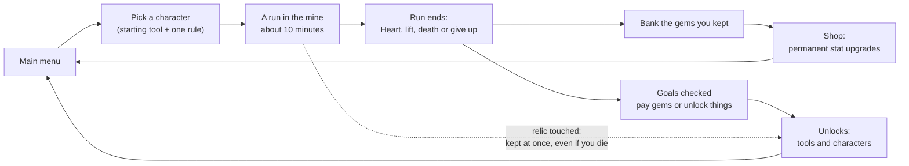
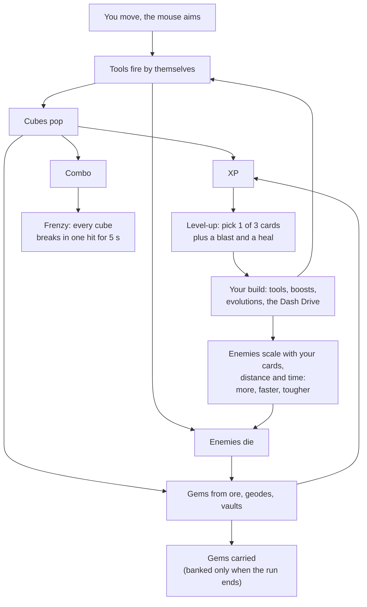
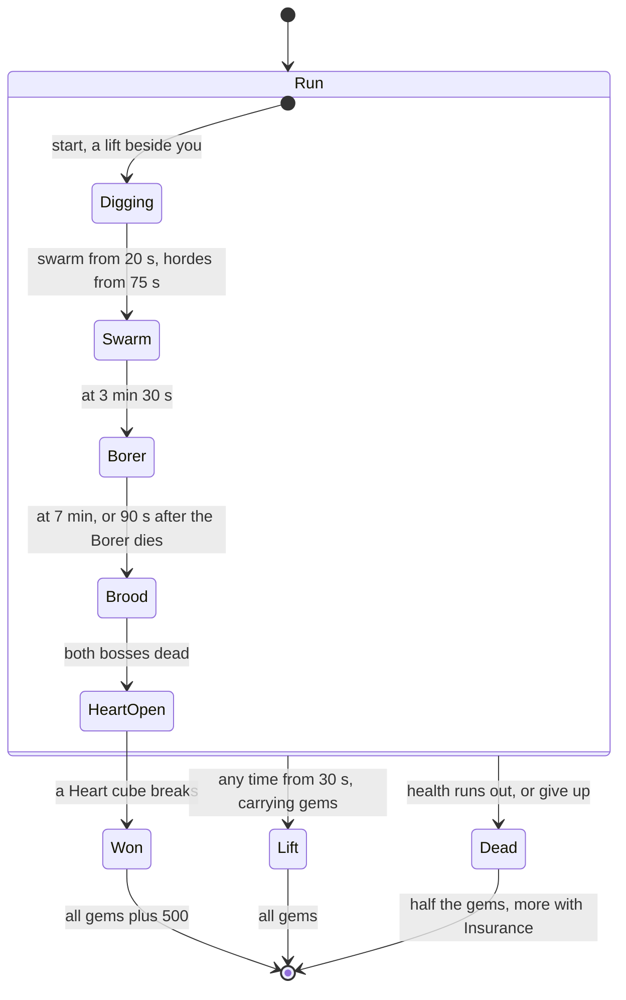
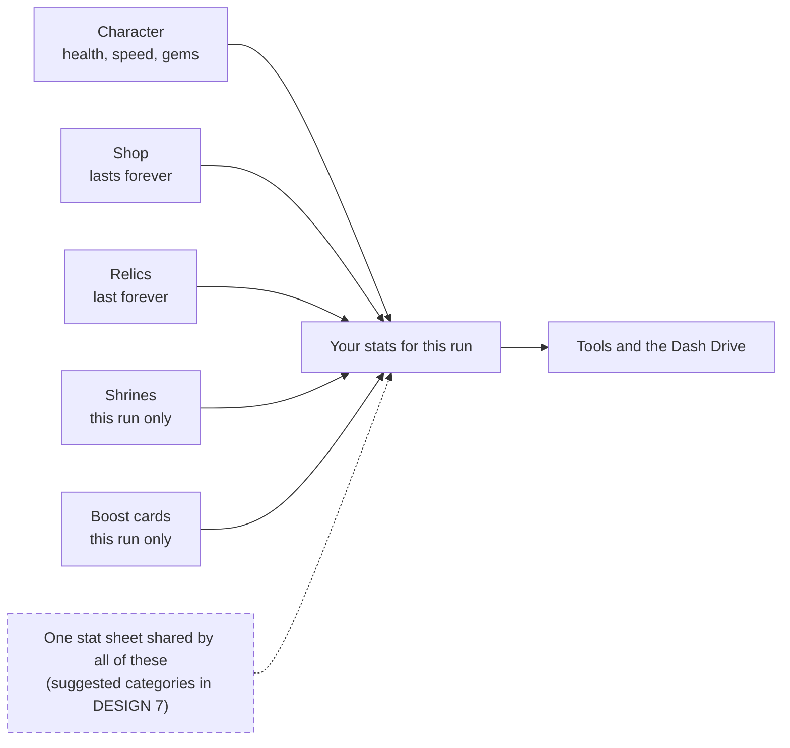
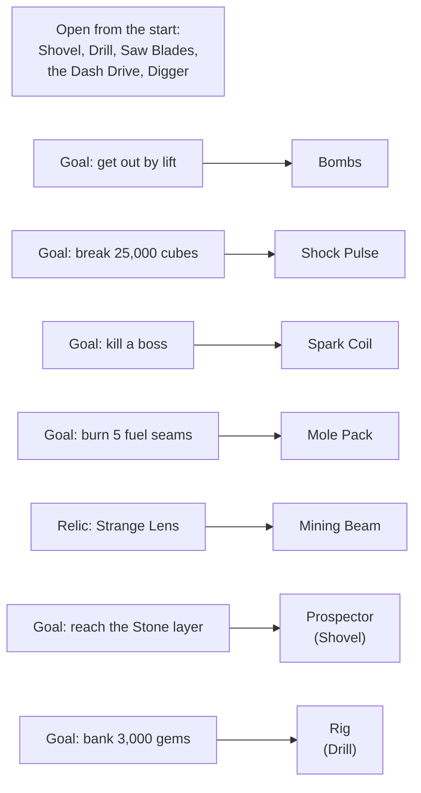
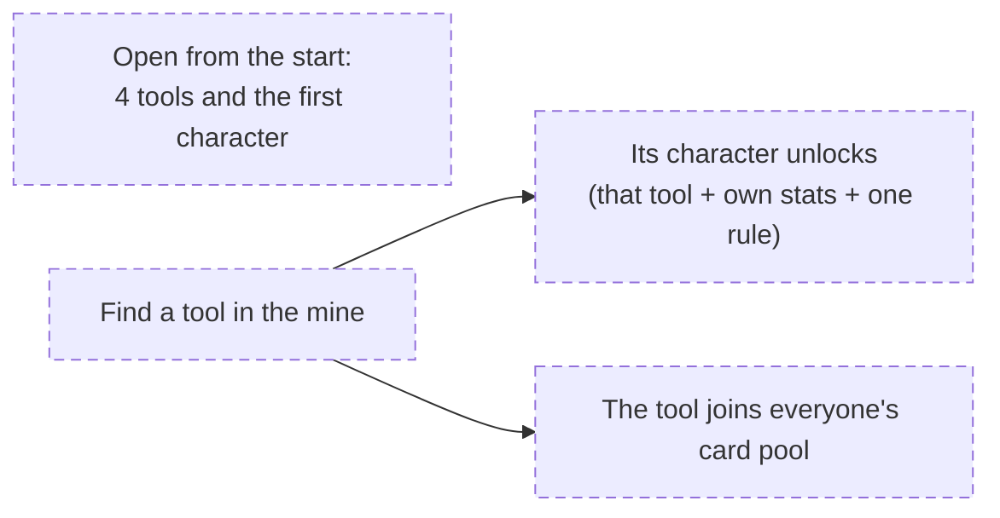

# Game structure

How DIG fits together, as diagrams. GitHub draws them from the text below (Mermaid), so edit the text, not a picture.
Boxes with a dashed border are **planned** (owner's decisions not built yet, see docs/DESIGN.md section 7); everything
else is how the game works now. Numbers and formulas are in docs/MECHANICS.md. Update this file in the same commit as
any change to the structure it shows.

## 1. The big loop

## 2. Inside a run

**What the mine holds**, found by digging, all random each run: ore and crystal, geodes, vaults, shrines (a trade for this
run), relic rooms, fuel seams, cracked rock that caves in, gas rock, nests and spike plates. The Heart is 190 m away in a
random direction: you find it by its beat and the pink veins.

## 3. A run's timeline and how it ends

## 4. Where your strength comes from

Enemies scale with the cards you picked in this run (tool, boost and Dash Drive levels), with distance from the start and with time. The shop, relics and evolutions don't count, so they are a true edge over enemies.

## 5. Unlocks

**Now:**

**Planned** (owner, 2026-11-05): each character brings their own tool. You find the tool in the mine, and that unlocks
the character, and the tool for every other character too. At least 4 tools are open from the start, so the first
character can play a whole run.

